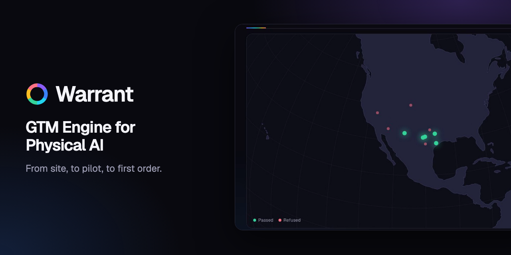

# Warrant - GTM Engine for Physical AI



**[Live app](https://warrant-sepia.vercel.app)** · **[Demo video](https://warrant-sepia.vercel.app/demo/warrant-demo.mp4)** · **[Project story](https://bouncypitch.github.io/warrant/)**

From site, to pilot, to first order.

Warrant researches any robotics company, finds real target customers, and builds a Pilot Pack for the best one. It refuses to contact anyone until a lead has a cited reason, a path in, positive expected value, verified claims, and human approval.

## Run it

```bash
pnpm install
cp .env.example .env.local   # add ANTHROPIC_API_KEY for live runs
pnpm dev
```

The three prepared demos work with no keys. Every other integration stays off until its keys are set, and the home page shows which are connected.

## Prepared demos

| Act | Seller | Targets |
|---|---|---|
| Power | Charge Robotics | Utility-scale solar projects |
| Compute | Watney Robotics | AI data center campuses |
| Factories | Path Robotics | Fabricators and shipyards |

These are public examples with no affiliation. Their outreach is draft-only, seller performance numbers are placeholders, and win rates and deal values are labeled assumptions.

## Safety

- Sending needs a human approval and a passing warrant, enforced on the server.
- Email goes only to `DEMO_INBOX`.

See [ARCHITECTURE.md](ARCHITECTURE.md) for the design.

## Brand assets

The logo, share image, and demo video are in [`public/brand`](public/brand) and [`public/demo`](public/demo).
